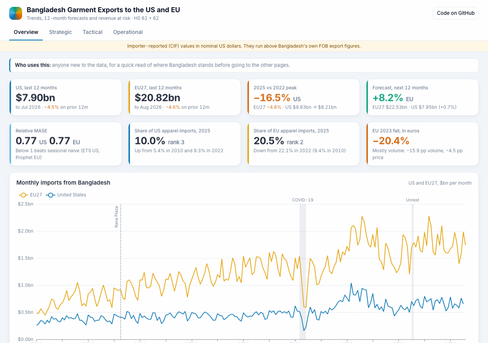
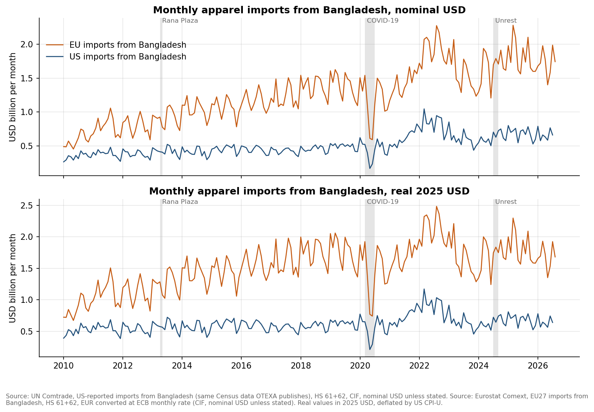
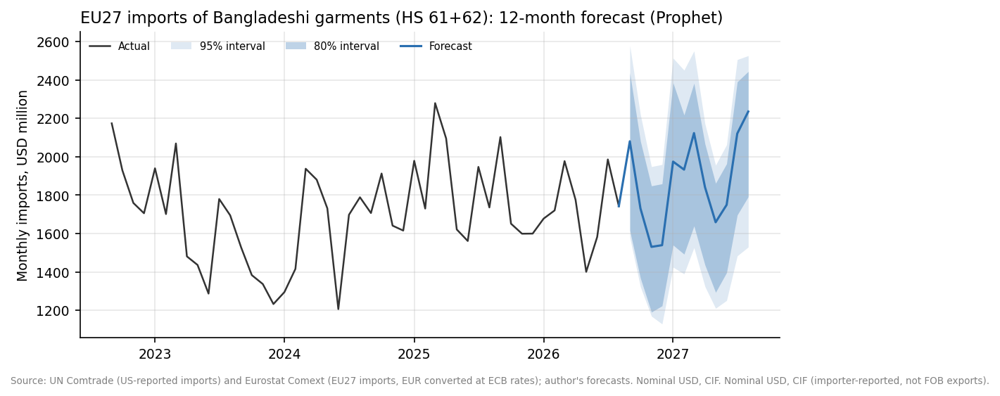
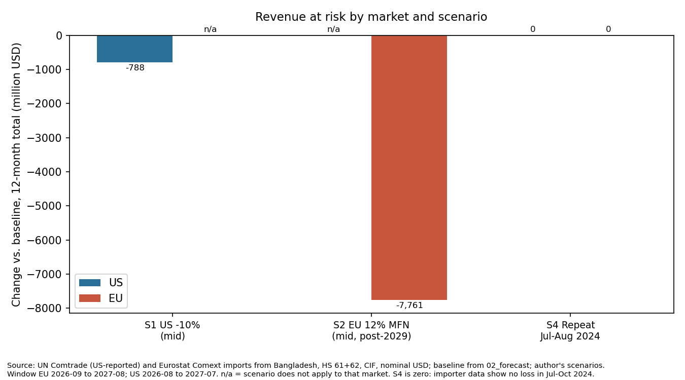
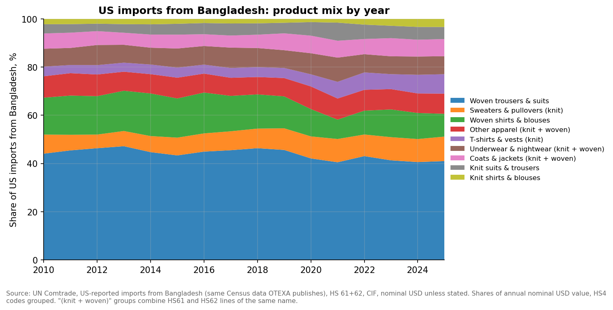
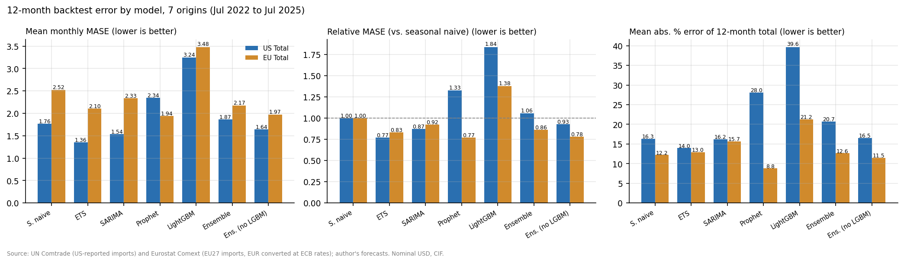

# Bangladesh Garment Exports: Forecasts and Scenarios for the US and EU

<p align="center"><a href="https://takyurp09.github.io/rmg-export-forecasting/"><strong>▶ Open the interactive dashboard</strong></a></p>

[](https://takyurp09.github.io/rmg-export-forecasting/)

Ready-made garments (RMG, HS chapters 61 and 62) are most of what Bangladesh exports, and the US and the EU buy most of them. This repo asks three questions a ministry analyst or a factory owner would ask. How have US and EU imports of Bangladeshi apparel moved since 2010? What will they be over the next 12 months, and how much better is that forecast than a naive guess? How much revenue is at risk if US demand falls, or if Bangladesh loses duty-free access to the EU after it leaves the UN list of Least Developed Countries (LDCs)?

All values are importer-reported (CIF) in nominal US dollars unless a table says otherwise.

## Key findings

- **Growth since 2010.** US imports from Bangladesh grew from $4.06bn in 2010 to $8.21bn in 2025 (4.8% a year). EU imports grew from $6.92bn to $21.90bn (8.0% a year). The EU27 took 54.6% of world imports from Bangladesh in 2023.
- **2022 was the peak.** Both markets peaked in 2022. By 2025 US imports were 16.5% below that peak ($9.83bn to $8.21bn) and EU imports 4.8% below ($23.00bn to $21.90bn). US sales also lean on one product: woven trousers and suits were 41.0% of US imports in 2025.
- **Gaining share in a shrinking US market.** Bangladesh's share of US apparel imports rose from 5.4% in 2010 to 10.0% in 2025, third after Vietnam and China. Between 2022 and 2025 the US market shrank 22.4%, so imports from Bangladesh still fell $1.62bn, but a higher share added $0.58bn.
- **Losing share in the EU.** Bangladesh is second in the EU (20.5% in 2025), but its share has slipped from 22.1% in 2022. China (+3.2 points) and Cambodia (+1.1 points) took share over the same years. The share loss cost $1.71bn while the market itself grew 2.6%.
- **Volume, then price.** In euros, EU imports from Bangladesh fell 20.4% in 2023. Most of that was volume: 15.9 points from fewer kilograms and 4.5 points from lower unit values. In Jan-Aug 2026 the fall (11.7%) is mostly price: 7.3 points from unit values and 4.4 points from volume.
- **Next 12 months: US flat, EU up 8%.** The selected models forecast $7.95bn for the US (+0.7%, Aug 2026 to Jul 2027) and $22.53bn for the EU (+8.2%, Sep 2026 to Aug 2027). In a rolling-origin backtest both beat the seasonal naive forecast, with a relative MASE of 0.77 each. The error on the 12-month total was 14.0% for the US and 8.9% for the EU.
- **Revenue at risk.** A 10% fall in US apparel demand cuts US imports from Bangladesh by about $0.79bn (range $0.63bn to $1.18bn). A 12% EU duty once preferences end (not before about Nov 2029) cuts EU imports by $7.76bn in the mid case (range $5.90bn to $12.60bn). This is the likely case without GSP+: under the current GSP rules, Bangladesh's apparel would probably be graduated out of standard GSP, so 12% would apply. A WTO study (Bekkers & Cariola 2022) puts the loss on all Bangladeshi goods to all preference-granting markets at $6.20bn. If standard GSP did apply (a 9.6% duty), the mid case here would be $6.54bn.
- **The 2024 unrest delayed shipments but did not lose them.** In all four market-chapter series, Jul-Aug 2024 imports came in 2.5% to 7.6% above what the first half of the year implied, and Sep-Oct 2024 was also above. In the importer data, a repeat of that shock costs $0.



| | |
|---|---|
|  |  |
|  |  |

## Dashboard

The [interactive dashboard](https://takyurp09.github.io/rmg-export-forecasting/) is set out by decision level, and each page says who uses it and for what:

| Page | For | Shows |
|---|---|---|
| Overview | Anyone | Headline KPIs and the monthly series since 2010 |
| Strategic | Ministry, BGMEA, exporters' boards | Share and rank against eight competitors (China+1), shift-share 2022-2025, product mix, market concentration |
| Tactical | Exporter planning teams, BGMEA analysts | 12-month forecast with backtest; S1 and S2 scenario sliders |
| Operational | The analyst who runs the monthly refresh | Latest months against last year, next 6 forecast months, EU price and volume, data status |

The business process behind it (users, decisions, data flow, KPI definitions) is in [docs/PROCESS.md](docs/PROCESS.md). It is a static site in `site/` built with ECharts from the same tables (`scripts/build_site_data.py`) and deployed by GitHub Pages.

The Power BI design is in the repo as text: Power Query scripts (`powerquery/`), a DAX measure library (`dax/measures.dax`), a report theme (`theme/report_theme.json`), the schema, data dictionary and page spec (`docs/`), and a build guide ([dashboard/POWERBI_BUILD_GUIDE.md](dashboard/POWERBI_BUILD_GUIDE.md)). `scripts/validate_model.py` checks the star schema (four dimensions, five facts).

The data are refreshed once a month through GitHub Actions; see [docs/PIPELINE.md](docs/PIPELINE.md).

## MIS410 mapping

| Course topic | Where in the repo |
|---|---|
| BI at operational, tactical and strategic levels | Dashboard pages; `docs/PROCESS.md` |
| Business-process analysis and design | `docs/PROCESS.md` (users, decisions, roles, KPIs) |
| Data extraction from multiple sources | `src/download_*.py`; `data/raw/SOURCES_*.md` |
| Automated data pipelines | `scripts/refresh_pipeline.py`, `.github/workflows/refresh.yml`, `docs/PIPELINE.md` |
| Data warehousing and quality | Star schema in `data/processed/powerbi/`, `docs/SCHEMA.md`, `scripts/validate_model.py` |
| Analytical model building | `notebooks/02_forecast.ipynb` to `05_price_volume.ipynb`, `src/models.py` |
| Web-based dashboards | `site/` (ECharts); Power BI files in `powerquery/`, `dax/`, `docs/DASHBOARD_SPEC.md` |
| ML applications | LightGBM and Prophet in the backtest (`src/models.py`) |

## Data

| Source | What | Period | Script |
|---|---|---|---|
| UN Comtrade, US as reporter | US monthly imports from Bangladesh, HS 61/62 by 4-digit heading | Jan 2010 to Jul 2026 | `src/download_us_comtrade.py` |
| Eurostat Comext (DS-045409) | EU27 monthly imports from Bangladesh, HS 61 and 62, converted from euros with ECB monthly rates | Jan 1999 to Aug 2026 | `src/download_comtrade.py` |
| UN Comtrade, all reporters | Annual imports from Bangladesh by market (185 markets; 2024-25 incomplete) | 2010 to 2025 | `src/download_comtrade.py` |
| Export Promotion Bureau (EPB) | Bangladesh's own RMG exports (FOB), monthly; only recent periods are online | Dec 2024 to Sep 2026 | `src/download_epb.py` |
| UN Comtrade (US) and Eurostat (extra-EU) | Apparel imports from Bangladesh and eight competitors, plus the total from all suppliers | Jan 2010 to Jul 2026 (US), Aug 2026 (EU) | `src/download_competitors.py` |
| Eurostat Comext (DS-045409) | EU27 imports from Bangladesh in kg, HS 61, 62 and nine 4-digit headings | Jan 2010 to Aug 2026 | `src/download_eu_quantity.py` |
| BLS | US CPI-U, for the real-dollar column | | `data/raw/fx/` |

The original sources were downloaded on 21 Oct 2026, the competitor data on 24 Oct 2026 and the EU quantities in Oct 2026. Endpoints and caveats are in `data/raw/SOURCES_*.md`.

## Methods

- **Cleaning** (`src/clean.py`). One long table (`data/processed/rmg_long.csv`) with date, market, chapter, product group and value. US 4-digit headings map to 12 product groups. The same script writes the Power BI star schema to `data/processed/powerbi/`.
- **Description** (`01_explore.ipynb`). STL decomposition, seasonal index, year-on-year growth by product, product shares, and market concentration (HHI).
- **Models** (`02_forecast.ipynb`, `src/models.py`). Seasonal naive, ETS with damped trend, SARIMA (order by AIC), Prophet, LightGBM on lags, and two equal-weight ensembles, run on 16 series: the US total and 12 US product groups, plus EU total, knit and woven.
- **Backtest.** Rolling origin with 7 origins, every 6 months from Jul 2022 to Jul 2025, and a 12-month horizon. Metrics are MAPE, RMSE, MASE, relative MASE (model over seasonal naive) and the error on the 12-month total.
- **Selection rule.** Keep the models within 1 point of the lowest 12-month-total error, then take the one with the lowest MASE. Ties go to the simpler model. Results are in `outputs/tables/best_model_by_series.csv`.
- **Scenarios** (`03_scenarios.ipynb`, `src/scenarios.py`). Each shock is applied to the 12-month baseline. S1 is a 10% drop in US demand, scaled by each product group's past sensitivity. S2 is a 12% EU MFN duty after EBA ends, using published tariff elasticities (low, mid, high). S2b uses the 9.6% standard-GSP duty instead, which is unlikely to apply. S4 repeats Jul-Aug 2024. A combined S1 + S2 stress test is kept as a side note in the notebook only. Each assumption and its source is listed in `outputs/tables/scenario_assumptions.csv`.

- **Competitors** (`04_competitors.ipynb`, `src/competitors.py`). Annual share of US and EU apparel imports for Bangladesh and eight competitors, rank, and a shift-share split of 2022-2025 changes into market size and share.
- **Price and volume** (`05_price_volume.ipynb`, `src/price_volume.py`). EU only. Unit value in euros per kg, and a log split of each year's value change into price and volume parts.
- **Refresh** (`scripts/refresh_pipeline.py`). Runs the downloads, cleaning, notebooks 01-05, validation and the site build in order; GitHub Actions runs it monthly.

## Reproduce

```bash
conda create -n rmg python=3.10 -y && conda activate rmg
pip install -r requirements.txt

# optional: download the raw data again (the repo already includes it)
python src/download_us_comtrade.py
python src/download_comtrade.py
python src/download_epb.py
python src/download_competitors.py
python src/download_eu_quantity.py

python src/clean.py                                                               # about 41 s
jupyter nbconvert --to notebook --execute --inplace notebooks/01_explore.ipynb    # about 12 s
jupyter nbconvert --to notebook --execute --inplace notebooks/02_forecast.ipynb   # about 8 min
jupyter nbconvert --to notebook --execute --inplace notebooks/03_scenarios.ipynb  # about 6 s
jupyter nbconvert --to notebook --execute --inplace notebooks/04_competitors.ipynb
jupyter nbconvert --to notebook --execute --inplace notebooks/05_price_volume.ipynb
python scripts/validate_model.py
python scripts/build_site_data.py

# or all of the above in one step
python scripts/refresh_pipeline.py --skip-download
```

The full run takes about 10 minutes on a laptop, most of it the backtest in 02.

## Repository structure

```
rmg-export-forecasting/
├── README.md
├── LICENSE
├── requirements.txt
├── src/
│   ├── download_us_comtrade.py   US monthly imports (Comtrade)
│   ├── download_comtrade.py      annual mirror data + Eurostat monthly
│   ├── download_epb.py           EPB monthly exports
│   ├── download_competitors.py   US and EU imports by supplier
│   ├── download_eu_quantity.py   EU imports in kg
│   ├── clean.py                  long table + Power BI tables
│   ├── explore_utils.py          plotting helpers
│   ├── models.py                 models, backtest, selection rule
│   ├── scenarios.py              scenario engine
│   ├── competitors.py            shares, ranks, shift-share
│   └── price_volume.py           unit values, price/volume split
├── notebooks/
│   ├── 01_explore.ipynb
│   ├── 02_forecast.ipynb
│   ├── 03_scenarios.ipynb
│   ├── 04_competitors.ipynb
│   └── 05_price_volume.ipynb
├── scripts/
│   ├── refresh_pipeline.py       monthly refresh, all steps
│   ├── validate_model.py         star-schema checks
│   └── build_site_data.py        site/data/*.json
├── site/                         web dashboard (GitHub Pages)
├── powerquery/, dax/, theme/     Power BI files
├── docs/                         PROCESS, PIPELINE, SCHEMA, DATA_DICTIONARY, DASHBOARD_SPEC
├── .github/workflows/            refresh.yml, pages.yml
├── data/
│   ├── raw/                      downloads + SOURCES_*.md
│   └── processed/                clean tables; powerbi/ star schema
├── outputs/
│   ├── figures/
│   ├── tables/
│   └── archive_v1/               first model-selection run, kept for comparison
└── dashboard/
    └── POWERBI_BUILD_GUIDE.md
```

## Limitations

- **Mirror data, not Bangladesh's own exports.** The series are what the US and EU record as imports (CIF). They run above Bangladesh's FOB figures, and EPB no longer posts its monthly FOB history, so FOB totals are not modelled.
- **Monthly data are noisy.** Even the seasonal naive has MASE above 1 on the 2022-26 test period, and seven origins cannot separate models that score within a point of each other.
- **Levels do not add up exactly.** The US group forecasts sum to $7.90bn while the US total model gives $7.95bn. The EU gap is similar. The scenarios use the group sums.
- **Scenarios rest on assumptions.** The S1 elasticity is the analyst's choice. S2 assumes full pass-through and no GSP+, and it sits on today's baseline although it could only apply after about Nov 2029. The EU GSP Regulation itself expires at the end of 2027 (EBA excepted), so the post-2029 rules are not yet known. The LDC graduation date (24 Nov 2026, with a deferral to 2029 requested) was still before the UN General Assembly on 24 Oct 2026.

## Use in teaching

The repo works as a case for a business analytics or forecasting course, with data Bangladeshi students know.

- **Backtesting lab.** Students rerun `02_forecast.ipynb` with a different origin schedule or an extra model and check whether the selected model changes. The lesson is to judge a model against a naive benchmark on data it has not seen.
- **Scenario exercise.** Students change one assumption in `src/scenarios.py` (an elasticity, the duty rate, GSP or no GSP) and explain how revenue at risk moves, then compare their S2 number with the published WTO estimate.
- **Dashboard assignment.** Students build the Power BI report from `data/processed/powerbi/` with the build guide.

## License and citation

Code and documentation are under the MIT License (see `LICENSE`). Raw data belong to their publishers (UN Comtrade, Eurostat, EPB, BLS).

Tahmid, M. T. (2026). *Bangladesh garment exports: forecasts and scenarios for the US and EU* [Code and data]. https://github.com/takyurp09/rmg-export-forecasting
