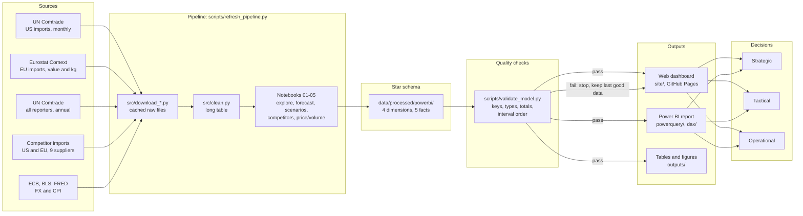

# Business process: who uses this and for what

This page describes the business process the repo supports: who needs the numbers, which decisions they make at each level, how data flow from the public sources to those decisions, and how often. The technical refresh steps are in [PIPELINE.md](PIPELINE.md); the data model is in [SCHEMA.md](SCHEMA.md).

## Users

| User | What they need | Main page |
|---|---|---|
| Exporter planning team (a garment group's merchandising or finance staff) | Expected orders by market and product for the next 12 months; early warning when a month falls short | Tactical, Operational |
| BGMEA research analyst | Monthly tracking of US and EU imports, share against competitors, input to briefings | Operational, Strategic |
| Ministry of Commerce or policy desk | Size of the risk from LDC graduation and the end of EU duty-free access; which markets to negotiate for | Strategic, Tactical (scenarios) |
| Faculty and students | A worked case of a BI system on local data: pipeline, star schema, forecasting, dashboard | All pages, notebooks |

## Decisions by BI level

| Level | Horizon | Decisions | Evidence in the dashboard |
|---|---|---|---|
| Strategic | 3 to 5 years | Which markets and product lines to grow or defend; how much to push for GSP+ or a later graduation date; whether to diversify away from woven trousers | Share by supplier and rank, shift-share 2022-2025, market and product concentration (HHI), product mix |
| Tactical | 6 to 18 months | Capacity and hiring plans, order intake targets, cash-flow plans; how much revenue is at risk under a demand fall or an EU duty | 12-month forecast with intervals, backtest, S1 and S2 scenario sliders |
| Operational | Each month | Is the newest month on track? Flag a shortfall to the planning team? Is a fall due to lower prices or fewer units? Did the refresh run cleanly? | Latest 6 months against last year, next 6 forecast months with the 80% range, EU price and volume split, data status |

## Data flow

## Refresh cadence

| What | When | How |
|---|---|---|
| Monthly data (US, EU, competitors, EU quantities) | 06:00 UTC on the 6th of each month | GitHub Actions runs `scripts/refresh_pipeline.py` and redeploys the site |
| Forecasts and backtest | Same run (notebook 02) | Models are refit on all data each month |
| Scenarios | Same run (notebook 03) | Baselines follow the new forecast; assumptions change only by hand in `src/scenarios.py` |
| Annual mirror data (all markets) | Same run; new years appear as reporters publish | Cached per year |
| Assumption review (graduation date, EU duty rules) | When the UN or EU decides; checked by hand | Update `scenario_assumptions` in `src/scenarios.py` |

## Roles

| Role | Responsibility |
|---|---|
| Data owner (repo maintainer) | Keeps the downloaders working, reviews failed runs, updates scenario assumptions |
| Pipeline (GitHub Actions) | Downloads, cleans, runs notebooks, validates, rebuilds site data, commits only when checks pass |
| Analyst (BGMEA or ministry) | Reads the Operational page after each refresh and flags months outside the 80% range |
| Planner (exporter) | Uses the Tactical page for the yearly plan and the scenarios for risk limits |
| Policy lead | Uses the Strategic page and the S2 scenario for trade negotiations |

## KPI definitions

| KPI | Definition | Source | Level |
|---|---|---|---|
| Last 12 months imports | Sum of the latest 12 monthly import values from Bangladesh, nominal USD (CIF) | `fact_exports` | Operational |
| 12-month growth | Last 12 months over the 12 months before, minus 1 | `fact_exports` | Operational |
| Same month last year change | Month value over the same month a year earlier, minus 1 | `fact_exports` | Operational |
| Forecast, next 12 months | Sum of the 12 monthly point forecasts from the selected model | `fact_forecast` (level = Total) | Tactical |
| 80% range | Lower and upper 80% interval bounds of the monthly forecast | `fact_forecast` | Tactical, Operational |
| Relative MASE | Backtest MASE of the model over that of the seasonal naive forecast; below 1 beats naive | `outputs/tables/best_model_by_series.csv` | Tactical |
| Revenue at risk | Baseline 12-month imports minus imports under the scenario | `fact_scenarios` | Tactical |
| Share of market | Imports from Bangladesh over imports from all suppliers in that market (EU: extra-EU), HS 61+62 | `fact_competitors` | Strategic |
| Rank | Position among the nine suppliers by import value in the year | `fact_competitors` | Strategic |
| Share effect | Change in share times the end-year market size (shift-share) | `outputs/tables/competitor_shift_share_2022_2025.csv` | Strategic |
| HHI | Sum of squared shares (in %) across markets or product groups; higher means more concentrated | `outputs/tables/hhi_by_year.csv`, DAX | Strategic |
| Unit value | EU import value in euros over net weight in kg | `fact_price_volume` | Operational |
| Price and volume effects | Split of the value change into unit-value and kg parts, using log shares, in percentage points | `fact_price_volume`, `outputs/tables/price_volume_annual.csv` | Operational |
