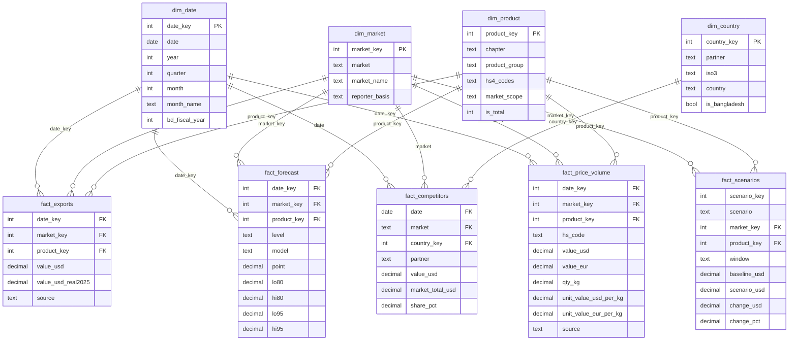

# Data model schema

The Power BI model is a star schema with four dimensions and five facts. All nine tables are CSVs in `data/processed/powerbi/`, loaded by the queries in `powerquery/`. `scripts/validate_model.py` checks the files against this page.

## Tables

| Table | Type | Grain | Primary key | Rows |
|---|---|---|---|---|
| `dim_date` | Dimension | One month, Jan 1999 to Aug 2027 | `date_key` | 344 |
| `dim_market` | Dimension | One importing market | `market_key` | 2 |
| `dim_product` | Dimension | One product group | `product_key` | 15 |
| `fact_exports` | Fact | Month x market x product group | `date_key, market_key, product_key` | 3,052 |
| `fact_forecast` | Fact | Forecast month x market x product x level | `date_key, market_key, product_key, level` | 192 |
| `fact_scenarios` | Fact | Scenario x market x product group | `scenario_key, market_key, product_key` | 72 |
| `dim_country` | Dimension | One supplier country, plus a WORLD row | `country_key` | 10 |
| `fact_competitors` | Fact | Month x market x supplier country, Jan 2010 on | `date, market, country_key` | 3,990 |
| `fact_price_volume` | Fact | Month x HS code, EU27 only, Jan 2010 on | `date_key, market_key, hs_code` | 2,400 |

`fact_scenarios` has no date. Each row covers a 12-month window stored as text in `window`.

## Relationships

All relationships are many-to-one, single cross-filter direction (the dimension filters the fact), and active.

| From (many) | To (one) | Cardinality | Direction |
|---|---|---|---|
| `fact_exports[date_key]` | `dim_date[date_key]` | *:1 | Single |
| `fact_exports[market_key]` | `dim_market[market_key]` | *:1 | Single |
| `fact_exports[product_key]` | `dim_product[product_key]` | *:1 | Single |
| `fact_forecast[date_key]` | `dim_date[date_key]` | *:1 | Single |
| `fact_forecast[market_key]` | `dim_market[market_key]` | *:1 | Single |
| `fact_forecast[product_key]` | `dim_product[product_key]` | *:1 | Single |
| `fact_scenarios[market_key]` | `dim_market[market_key]` | *:1 | Single |
| `fact_scenarios[product_key]` | `dim_product[product_key]` | *:1 | Single |
| `fact_competitors[date]` | `dim_date[date]` | *:1 | Single |
| `fact_competitors[market]` | `dim_market[market]` | *:1 | Single |
| `fact_competitors[country_key]` | `dim_country[country_key]` | *:1 | Single |
| `fact_price_volume[date_key]` | `dim_date[date_key]` | *:1 | Single |
| `fact_price_volume[market_key]` | `dim_market[market_key]` | *:1 | Single |
| `fact_price_volume[product_key]` | `dim_product[product_key]` | *:1 | Single |

## Model settings

- Mark `dim_date` as the date table on `dim_date[date]`.
- Sort `dim_date[month_name]` by `dim_date[month]`.
- Hide the key columns in the three fact tables.
- Put every measure in an empty `_Measures` table (see `dax/measures.dax`).

## Rules the data follow

- Product keys depend on the market. The US uses 12 product groups (keys 1, 3-11, 13, 14). The EU uses two chapter-level rows: key 2 (knit, HS 61) and key 12 (woven, HS 62). So the same `product_group` name, for example "Coats & jackets", appears twice in `dim_product`, once for knit and once for woven. The Power Query step adds `product_label` (chapter - group) to tell them apart.
- Key 15 ("All products", `is_total = 1`) appears only in `fact_forecast` rows with `level = "Total"`. `fact_exports` has no total rows, so market totals come from summing.
- `fact_forecast` holds both group-level and total rows. Summing both double counts; the forecast measures filter on `level`.
- Each market's forecast starts the month after its last actual month: US Aug 2026 to Jul 2027, EU Sep 2026 to Aug 2027.
- `scenario_key` is not unique on its own. Scenarios 8 (S3) and 9 (S4) cover both markets, so the key is `scenario_key, market_key, product_key`. There is no scenario dimension; slicers use `fact_scenarios[scenario]` directly.
- `change_pct` is a fraction and equals `change_usd / baseline_usd`. Do not average it across rows.
- `fact_competitors` joins `dim_date` on the `date` column and `dim_market` on the `market` text, not on keys. Country key 10 (`WORLD`) holds the market total from all suppliers; share measures divide by it and leave it out of supplier visuals. `share_pct` is a percentage (0-100) for that month; for a year, rebuild the share from values (`[Share of Market (supplier)]`).
- `fact_price_volume` covers the EU only. Its rows overlap: `hs_code` "61" and "62" (product keys 2 and 12), "61+62" (key 15) and nine HS4 headings with a blank `product_key`. Sum "61" and "62" only. The validator checks that they add up to the "61+62" row.
- S3 (scenario key 8) stays in `fact_scenarios` for notebook 03. The report pages leave it out.

## Known limits

- The importer-country HHI in `outputs/tables/hhi_by_year.csv` needs data for every importer and is not in this model. The measures compute concentration across product groups and across the two markets only.
- There are no US quantities in the model. US weight data were incomplete in early years (see `outputs/tables/price_volume_us_weight_coverage.csv`), so the price and volume split is EU only.
- EU and US values are not exactly comparable: both are importer-reported CIF, but EU values are converted from EUR at monthly ECB rates.
